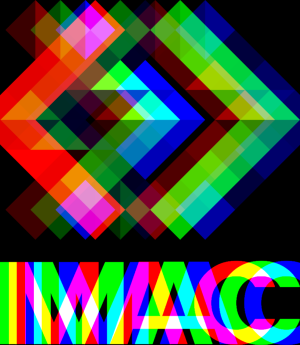
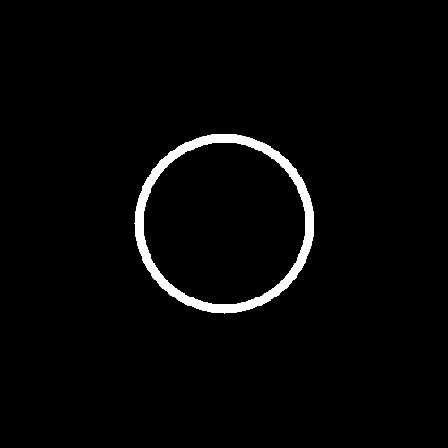
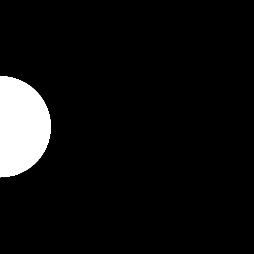
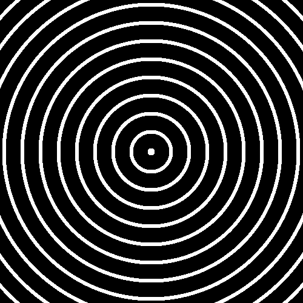
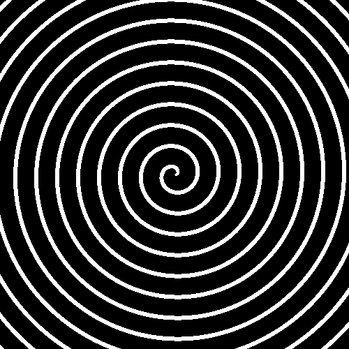
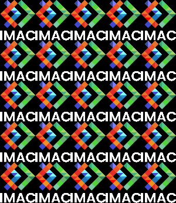
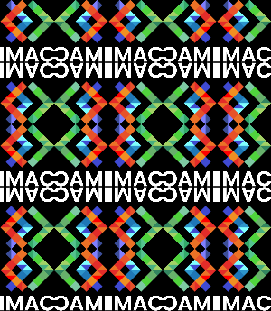
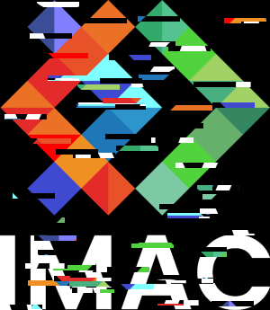

# Workshop Prog : Effets sur images (C++)

*Pierre CASIER*
*IMAC3*

**Sommaire** 

- [Workshop Prog : Effets sur images (C++)](#workshop-prog--effets-sur-images-c)
  - [1. Ne garder que le vert](#1-ne-garder-que-le-vert)
  - [2. Échanger les canaux](#2-échanger-les-canaux)
  - [3. Noir \& Blanc](#3-noir--blanc)
  - [4. Négatif](#4-négatif)
  - [5. Dégradé](#5-dégradé)
  - [6. Miroir](#6-miroir)
  - [7. Image bruitée](#7-image-bruitée)
  - [8. Rotation de 90°](#8-rotation-de-90)
  - [9. RGB split](#9-rgb-split)
  - [10. Luminosité](#10-luminosité)
  - [11. Disque](#11-disque)
  - [12. Cercle](#12-cercle)
  - [13. Animation](#13-animation)
  - [14. Bonus cercles](#14-bonus-cercles)
  - [15. Bonus spirale](#15-bonus-spirale)
  - [16. Mosaïque](#16-mosaïque)
  - [17. Mosaïque miroir](#17-mosaïque-miroir)
  - [18. Glitch](#18-glitch)

## 1. Ne garder que le vert

| Avant | Après |

|  |  |

## 2. Échanger les canaux

| Avant | Après |

|  |  |

## 3. Noir & Blanc

 

## 4. Négatif

 

## 5. Dégradé

 

## 6. Miroir

| Avant | Après |

|  |  

Au départ, sur cet exercice j'ai eu du mal à comprendre la mécanique de *"image_copy.pixel(x, y) = image.pixel(image.width() - 1 - x, y)"* qui indique que le pixel *x* prend la place du pixel en *width - 1 - x*. 

Au final, après plusieurs tentatives, j'ai compris l'idée et j'ai d'ailleurs pu réutiliser cette logique dans un futur programme *Mosaïque miroir*.

## 7. Image bruitée

L'image bruitée a été un exercice un peu plus facile à prendre en main pour moi. En effet, cette notion de pixel aléatoire qui change de couleur était plus facile à comprendre et à mettre en place que celle du miroir.

## 8. Rotation de 90°

Pour la rotation, j'ai mis un peu beaucoup de temps à comprendre que c'était la *height* qu'il fallait que je modifie...
Mais une fois que j'avais compris cela, la logique était très similaire à celle du miroir, donc j'ai pu aller assez rapidement.

## 9. RGB split

J'ai plutôt bien compris cet exercice. L'idée de décaler soit le r (red), soit le g (green), soit le b (blue) d'un pixel m'est assez rapidement venue à l'esprit. Donc, j'étais assez content !

*image_copy.pixel(x, y).r = image.pixel(x + nb_pixel, y).r;*

En revanche, j'ai eu du mal à comprendre la condition pour les *x* qui sortent de l'image. Je vous ai d'ailleurs demandé de l'aide à ce moment de l'exercice !
En effet, j'avais une erreur qui m'indiquait que je cherchais à traiter des *x* qui n'étaient pas dans l'image, ce que le programme ne permettait pas, à juste titre. Maintenant, au moment d'écrire ce document, j'ai compris cette condition qui indique qu'on ne doit traiter que ce qui est dans la largeur de l'image.

*if (x + nb_pixel < image.width())*
*if (x - nb_pixel >= 0)*

## 10. Luminosité

| Original | éclaircissement | assombrissement |

|  |  |  |

Pour cet exercice, j'ai fait deux fonctions, *light_bright* et *light_dark*. Ces deux fonctions ont presque le même code, la seule différence étant l'opérateur (* ou /). Ces deux opérateurs sont appliqués aux valeurs RGB des pixels. Je sais qu'il existe d'autres moyens de faire augmenter ou diminuer la luminosité d'une image. J'ai notamment vu des solutions en allant sur des forums, mais j'ai préféré garder cette manière-là, car c'est celle que j'ai réussi à faire tout seul.

## 11. Disque

 

Pour ce programme, je n'ai pas eu de difficultés particulières.

## 12. Cercle

Pour celui-ci, par contre, ça a été un peu plus dur, car je n'ai pas réussi pendant un temps à bien utiliser *rayon* et *thickness*. En effet, je savais que je devais les utiliser, mais je n'avais pas compris comment. À force d'essayer, j'ai finalement réussi à comprendre et donc à réussir l'exercice.

## 13. Animation

  

Pour celui-là, non-plus, je n'ai pas eu de difficultés particulières.

 ## 14. Bonus cercles

  

Ici, je voulais simplement essayer de voir si je pouvais faire des cercles dans des cercles, à la manière de poupées russes. Ce code m'a permis d'utiliser le modulo *%*, que je ne maîtrisais pas bien du tout. 

 ## 15. Bonus spirale

  

Pour cet autre bonus, je suis aussi parti du programme d'avant. Cette fois-ci, pour cet effet, il fallait que je prenne en compte non seulement l’espacement, mais aussi l’angle par rapport au centre, afin d’avoir une spirale. 

Au départ, je ne voyais pas du tout comment m’y prendre. J’ai donc commencé par changer toutes mes constantes en float (avant int). Ensuite, j’ai eu une erreur m’indiquant que je ne pouvais plus utiliser le modulo traditionnel *%*, qui ne fonctionne qu’avec des entiers. J’ai donc découvert *std::fmod*, qui permet de faire un modulo avec des float (super!).

Après completement effrayé, j’ai compris qu’il fallait que je fasse de la trigonométrie... Notamment avec le nombre *pi* que j'ai arrêté à 4 chiffres après la virgule. J’ai aussi découvert en fouillant dans la doc de w3schools, la fonction *atan2()*. Elle permet selon les dire de cette doc et de google, de calculer l’angle entre l’axe positif des x et le vecteur partant du centre de l’image vers le point (*x, y*).

*float const angle{std::atan2(diff_y, diff_x)};*

*float const reste{std::fmod(distance - decalage + 10 * espacement, espacement)};*

Et ensuite comme la logique du code restait à peu près la même, j'ai finalement réussi à faire cette spirale !

## 16. Mosaïque

  

Pour celui-là, j'ai rencontré des difficultés sur la manière de réduire l'image. En effet, je n'avais pas pensé à créer une autre fonction *downscale*, et à cause de cela j'ai perdu beaucoup de temps (merci monsieur de m'avoir donné cette idée !).

## 17. Mosaïque miroir

  

Pour cet exercice, j'ai repris la logique de la mosaïque précédente. J'ai au départ assez bien réussi à faire un changement sur l'axe horizontal et un changement sur l'axe vertical. En revanche, j'ai eu beaucoup de mal à changer les deux en même temps, dans une logique de reflet de miroir, donc avec quatre reflets différents. Je suis donc venu vous voir pour vous demander de l'aide, et je vous remercie pour ce que vous avez fait. J'ai pu comprendre qu'il me manquait dans le code une condition pour voir si le compteur était pair ou impair.

*if (y != 0 && y % small.height() == 0)*
ou
*if (compteur_y % 2 == 0)*

Cela permet d'indiquer quel axe (*x* ou *y*) il faut modifier ou non.

 ## 18. Glitch

  

Pour le glitch, il n'y a pas eu de difficultés particulières. J'ai simplement repris la logique du programme noise, en l'adaptant cette fois-ci à des rectangles (4 côtés).